<p align="center">
  <picture>
    <source media="(prefers-color-scheme: dark)" srcset="frontend/src/assets/chopchop-logo.png">
    
  </picture>
</p>

# ChopChop walkthrough

ChopChop turns a song into material you can play with. It splits a track into stems, chops
them on the hits or on the beat grid, and builds drum kits and sound bits named with their
key and tempo. Everything runs on your own computer, and the separation models use your
GPU when there is one.

This page walks through the app screen by screen. For installing and running it, see the
[README](README.md).

**Contents**

1. [Projects](#1-projects)
2. [Separate a track into stems](#2-separate-a-track-into-stems)
3. [The project view](#3-the-project-view)
4. [Chopping](#4-chopping)
5. [Exporting](#5-exporting)
6. [Drum kits and sound bits](#6-drum-kits-and-sound-bits)
7. [Drum pads](#7-drum-pads)
8. [The sample browser](#8-the-sample-browser)
9. [Batch: a whole folder at once](#9-batch-a-whole-folder-at-once)
10. [Workflows](#10-workflows)
11. [Models](#11-models)
12. [Command line](#12-command-line)
13. [GPU speed and tuning](#13-gpu-speed-and-tuning)
14. [Keyboard shortcuts and undo](#14-keyboard-shortcuts-and-undo)
15. [How the detection works](#15-how-the-detection-works)

---

## 1. Projects

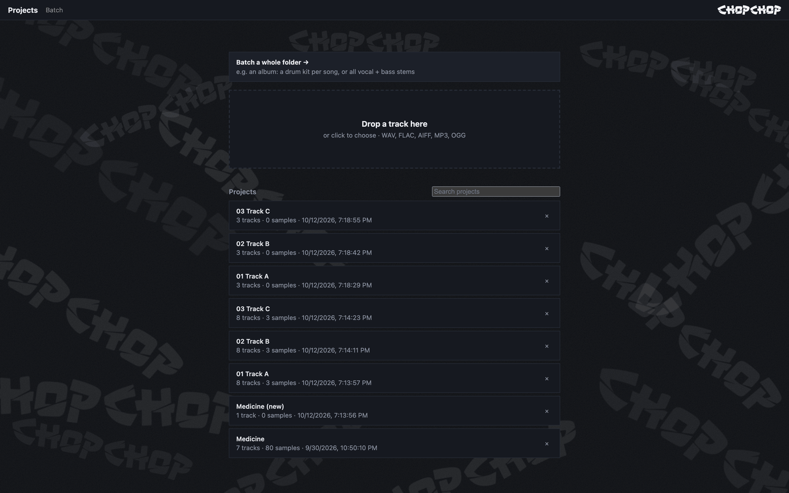

The start page. **Drop a track** (WAV, FLAC, AIFF, MP3 or OGG) to create a project, or
open one you've worked on before. Each project keeps its stems, slices, samples and pads.

- **Search projects** finds a project by name (case doesn't matter).
- **×** deletes a project with all its stems and samples.
- **Batch a whole folder →** runs a workflow over an album (see [Batch](#9-batch-a-whole-folder-at-once)).

Projects live in `data/projects/`, and downloaded models in `data/models/`.

---

## 2. Separate a track into stems

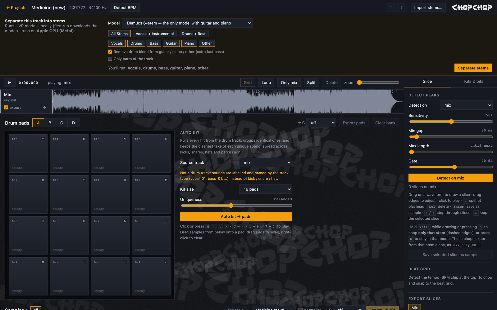

A new project starts with just the mix. Choose a **model** and which **stems** you want,
then click **Separate stems**. The banner shows where it runs, e.g. **Apple GPU (Metal)** or
your NVIDIA card. The first run with each model downloads it.

### Models

The scores are audio-separator's published quality scores (SDR; higher is cleaner). When
you keep only one kind of stem, the panel suggests the best model for it. More models can
be added on the [Models](#11-models) page.

| Model | Stems | Best for |
|---|---|---|
| Demucs 6-stem (default) | vocals, drums, bass, guitar, piano, other | the only one with guitar / piano |
| Demucs 4-stem fine-tuned | vocals, drums, bass, other | **drums** (10.0 dB); slow |
| Demucs MMI | vocals, drums, bass, other | **bass** (12.2 dB) |
| Demucs 4-stem | vocals, drums, bass, other | speed |
| Mel-Band Roformer | vocals, instrumental | **vocals** (12.6 dB); slow |
| BS-Roformer | vocals, instrumental | instrumental (16.5 dB) |
| MDX-Net Kim Vocal 2 | vocals, instrumental | the classic UVR vocal model (10.2 dB); fast |
| MDX-Net Inst HQ 4 | vocals, instrumental | a clean instrumental (15.5 dB); fast |
| Two-stage: Mel-Band → Demucs 6-stem / fine-tuned | as Demucs | the cleanest instrument stems |

The bass-*specialist* models audio-separator offers (kuielab bass, 10.4 dB) score lower than
Demucs, so they aren't included.

**Two-stage** first takes the vocals out with the best vocal model, then runs Demucs on the
*instrumental*, so no vocals leak into drums, bass, guitar, piano or other. On a test song
with known stems, the instrument stems summed together scored 29–31 dB against the true
instrumental, versus 2.5 dB for Demucs alone; vocals scored 39.8 dB vs about 0 dB. The cost:
isolated drums and bass come out about 1 dB lower.

### Choosing stems

- **Presets** (*All stems*, *Vocals + instrumental*, *Drums + rest*), or tick any mix of
  stems.
- **The stems you leave out** can be mixed into one extra track: `instrumental` when only
  vocals are kept, `no_drums` when only drums are, `rest` otherwise. Or drop them.
- **Remove drum bleed** is on whenever the model has a drums stem. The models leave faint
  drums in *other* (and *guitar*, *piano*), and those sharp attacks would make sound bits
  cut from *other* come out as drum hits.
  - One extra fast Demucs pass per stem finds that bleed. It's subtracted from the stem and
    added to *drums*, so nothing is lost and the stems still sum to the mix.
  - On a test song, the drums left in *other* fell from −35.6 dB to −60.7 dB.
  - Bass is left alone, because the pass would pull out 808s.
- **Separate…** in the top bar runs it again later with another model or choice. It
  replaces the current stems, and one undo brings them back.
- **Import stems…** adds stems you already have, e.g. from the UVR app.

### Separate only part of the song

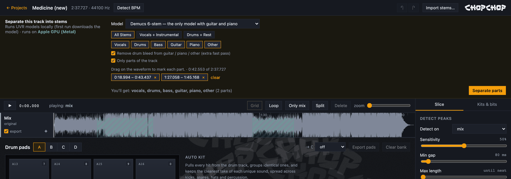

Tick **Only parts of the track**, then drag across the waveform to mark each part (green), or
add the selected slice. Only those parts are separated, in a single model run with a second
of context around each, so a 40-second section takes a fraction of the time a full song
does. The stems are silent everywhere else but stay full length, so they still line up with
the mix.

---

## 3. The project view

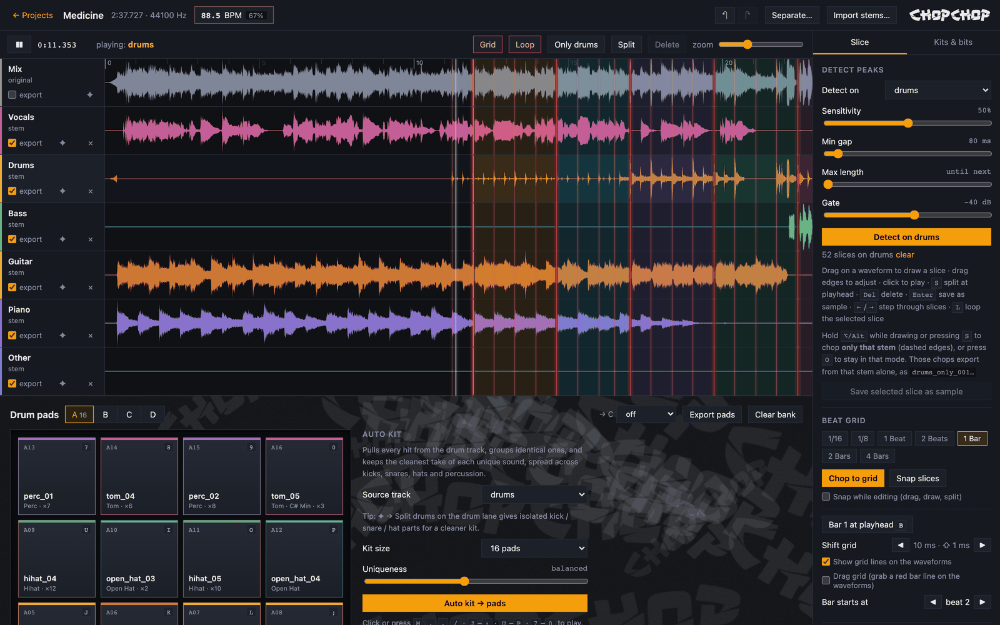

Every stem gets its own lane under the original mix, all on one timeline.

- **Top bar:** the project name and length, the **tempo** chip (88.5 BPM here, with its
  confidence), undo / redo, **Separate…**, **Import stems…** and **Workflow…** (run a
  [workflow](#10-workflows) on this project).
- **Transport:**
  - play / pause, and which lane is playing (click a lane's name to switch);
  - **Grid** shows the red beat grid;
  - **Loop** repeats the selected chop;
  - **Only <stem>** chops the focused stem alone;
  - **Split** / **Delete** for slices;
  - the **zoom** slider.
- **Lanes:** each lane has an **export** tick (include it when exporting slices), the
  **✦** stem tools, and **×** to remove it.
- **Stem tools (✦)** run on one stem and add new lanes, as one undo step each:
  - **Split drums** (MDX23C DrumSep) makes `drums_kick`, `drums_snare`, `drums_toms`,
    `drums_hihat`, `drums_ride` and `drums_crash`;
  - **Remove reverb** (Mel-Band Roformer) makes `<stem>_dry` and `<stem>_reverb`;
  - **Lead / backing vocals** (Mel-Band Roformer karaoke) makes `<stem>_lead` and
    `<stem>_backing`.

The tempo is detected from the drums once there's a drum stem. It copes with swing and with
live, unquantized playing; the **BPM** chip shows the details, the confidence and the
half / double-time alternatives, and lets you type a value or tap the tempo
([how it works](#15-how-the-detection-works)).

---

## 4. Chopping

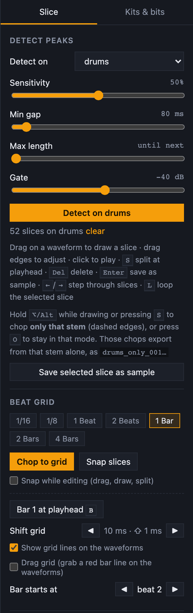

The **Slice** tab offers three ways to chop:

- **Detect peaks** finds every hit on the chosen track. Sensitivity, minimum gap, maximum
  length and a gate tune it. Slices start right on the attack, with no silence in front.
- **Beat grid:** pick a step (1/16 up to 4 bars) and **Chop to grid**. That gives one
  slice per cell, e.g. 1-bar loops. **Snap slices** moves every edge onto the grid, and
  **Snap while editing** does the same as you drag, draw or split.
- **By hand:** drag on an empty part of a waveform to draw a slice, drag its edges to
  resize it, and **Ctrl+drag** (or **⌘+drag**) it to move it. A plain drag on a slice scrolls
  the view left and right instead. **S** splits at the playhead.

Slices are colour-coded so you can see where one chop ends and the next starts. They appear
on every lane, so you can audition the same chop across all stems. Click one to play it, or
use **← / →** to step through them. With **Loop** on (**L**), the selected chop keeps
repeating. **Enter** saves the selected slice as a sample.

### Fixing the beat grid

The grid follows the tracked beats, so it stays aligned with a drummer who drifts. It's drawn
as thin red lines, brighter on bar lines; zoomed out, it thins itself out. If it starts in
the wrong place:

- **Bar 1 at playhead** (**B**): put the playhead on the hit where a bar really starts. The
  grid shifts so a beat lands exactly on that hit. A rough position is fine: it snaps to the
  nearest drum attack.
- **Drag grid**: tick it, then drag a red bar line to slide the whole grid.
- **Shift grid ◀ ▶** moves it 10 ms per click (1 ms with Shift).
- **Bar starts at beat ◀ n ▶** changes only which beat counts as 1.

All of these can be undone.

### Chop one stem only

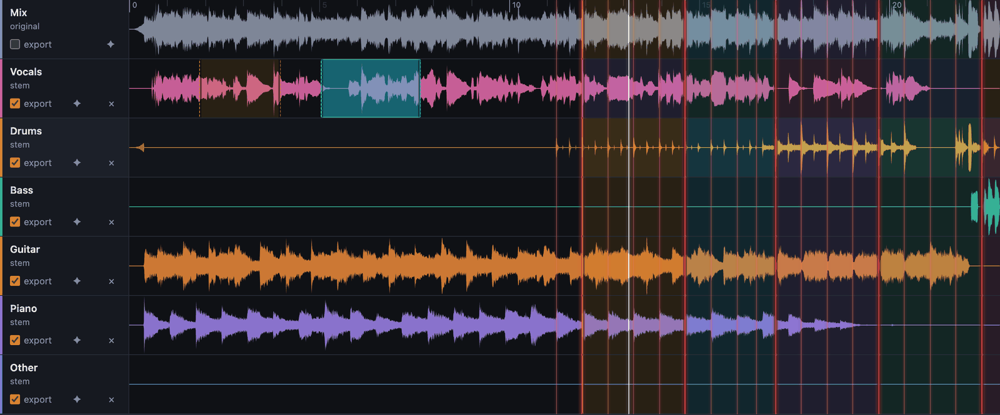

Hold **⌥/Alt** while drawing or pressing **S**, or press **O** (or **Only <stem>**) to stay
in that mode, where **Detect**, **Chop to grid** and **clear** also work on just the focused
stem. These chops have dashed edges and appear only on their stem's lane (on the vocals
above). They export from that stem only, as `vocals_only_001.wav` …, so the shared chops keep
their lined-up numbering. Removing the stem removes its chops.

---

## 5. Exporting

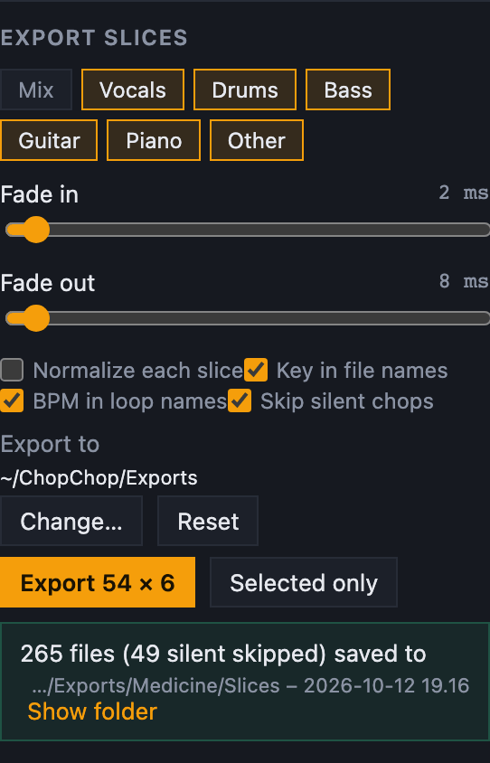

### Slices

- **Tracks:** choose which stems to export from (the lane ticks). Each gets its own folder.
- **Options:** fades, normalizing, and **key** and **BPM** in the file names.
- **Skip silent chops** (on by default) leaves out a chop on any stem where it's silent or
  nearly so (its peak more than 40 dB below that stem's loudest moment), e.g. a vocal stem
  during the beat intro. Above, 49 such files were skipped. The numbering stays in step, so
  `drums_005` and `vocals_005` are still the same moment.
- The export runs in the background, with a progress bar.

### The export folder

Choose an export folder once (**Export to → Change…** in the Slice panel, or the batch
page's output folder) and it's remembered across restarts, in `data/settings.json`. Every
export uses it:

| Export | Goes to |
| --- | --- |
| Slices | `<export folder>/<project>/Slices – <date time>/<track>/…` |
| Export kit (sample browser) | `<export folder>/<project>/Kit – <date time>/…` |
| Export pads | `<export folder>/<project>/Pads – <date time>/…` |
| A workflow run on a project | `<export folder>/<project>/<workflow> – <date time>/…` |
| Batch runs | `<export folder>/<input folder> – <date time>/<song>/…` |

Every export gets a new folder, so nothing is overwritten, and the result line has a
**Show folder** button. **Reset** clears the setting: project exports then download as a zip,
and batches go to `data/batches/`.

### File names

Every export uses `<name>[_<bpm>bpm][_<key>].wav`:

| Example | Why |
|---|---|
| `bass_001_96bpm_A2.wav` | a 2-beat bass loop: BPM plus its detected note |
| `drums_004_96bpm.wav` | a 1-bar drum loop: BPM, but no key (a drum loop has none) |
| `kick_01_F#1.wav` | a one-shot: no BPM, plus the kick's pitch |
| `A09_hihat_01.wav` | a pad export; hats and snares never get a key |

- **BPM** is added only to sounds at least about one beat long (loops, phrases), using the
  project tempo. Drum hits never get one.
- **Key** comes from the sample's detected (or hand-edited) key. Slice exports detect it per
  slice; turn that off with **Key in file names**.

---

## 6. Drum kits and sound bits

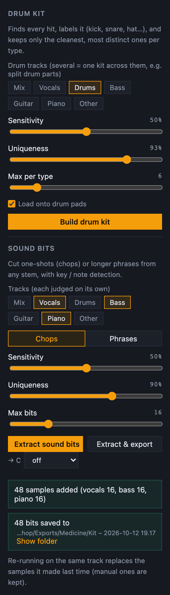

The **Kits & bits** tab works on one or more tracks:

- **Build drum kit** finds every hit and labels it (kick, snare, clap, hihat, open hat,
  cymbal, tom, perc). It keeps the cleanest, most distinct take of each sound: identical hits
  are grouped and counted. Several tracks build one kit across them, e.g. the split drum
  parts. **Load onto drum pads** lays it out on the pads.
- **Sound bits** cuts one-shots (**Chops**) or longer **Phrases** from any stem, with key /
  note detection. Each stem is judged on its own, so quiet vocals next to loud bass still
  give bits. Leftover bleed you can't hear in the song is ignored, so a near-empty stem
  doesn't turn into a folder of stray drum hits.
- **Extract & export** does both in one click: it extracts, then exports just the new bits.
- **→ C** also exports every keyed sample transposed to C (see [the sample browser](#8-the-sample-browser)).

The result line says how many samples came from each track. Running it again on the same
track replaces the samples it made last time; samples you made by hand are kept.

---

## 7. Drum pads

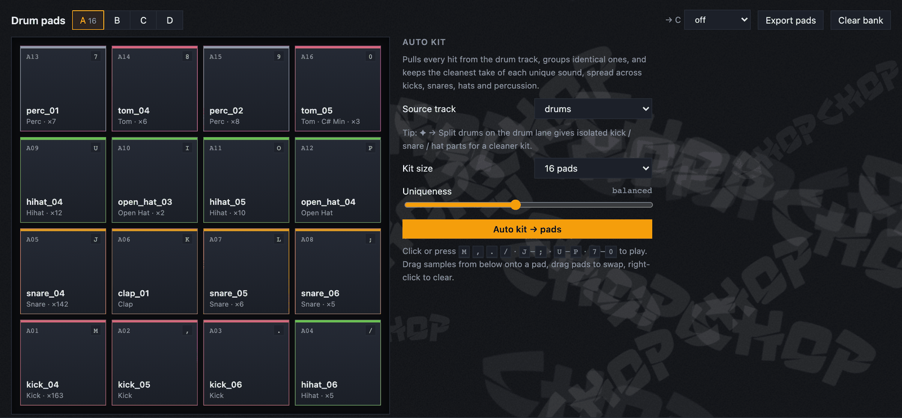

The pads have 4 banks × 16, laid out like an MPC.

- **Auto kit → pads** builds a 16-pad kit from the drum stem and loads it onto bank A: kicks
  on the bottom row (A01–A04), then snares and claps (A05–A08), hats (A09–A12), and perc and
  toms on top (A13–A16).
- Each pad shows how often its sound occurs in the song (`×163`) and its note, if it has one.
- **Playing:** click a pad, or use the keys on the pads, bottom row to top: **M , . /**,
  **J K L ;**, **U I O P**, **7 8 9 0**. A closed hat chokes a ringing open one.
- **Loading:** drag a sample onto a pad, or select a pad and press ⊞ on a sample. Drag pads
  onto each other to swap them; right-click to clear.
- **Export pads** writes `A01_kick_04.wav` … in pad order, with the same **→ C** option.

---

## 8. The sample browser

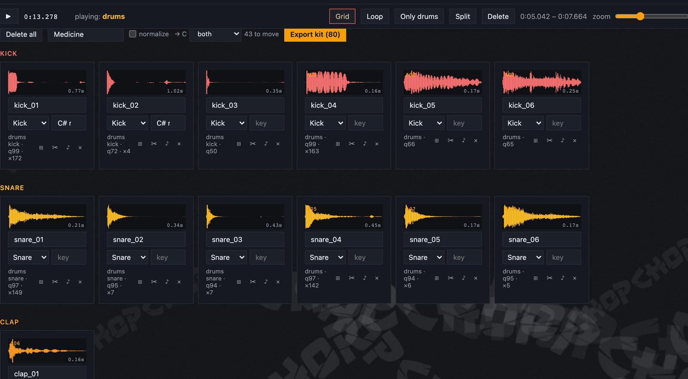

All samples, grouped by category, with a waveform, length, quality score and how often each
one occurs.

- **Edit:** play, rename, recategorize, set or re-detect the key (♪), trim (✂), or load a
  sample onto the selected pad (⊞).
- **Filter** by category or source track, then **Export kit** for what's shown. Files are
  named `<category>/<name>_<key>.wav`.
- **→ C** also exports every keyed sample transposed to C, each way in its own folder:
  - `In C (repitched)/`: resampled like a sampler, so length and tempo change (a loop's BPM
    tag is updated);
  - `In C (warped)/`: pitch-shifted, same length;
  - **both** writes the two folders.

  Notes move to the nearest C, at most 6 semitones (`F#1` → `C1`); keys keep their mode
  (`A min` → `C min`). Samples already in C, or without a key, aren't repeated. The choice
  is remembered, and shared with **Export pads**. Above, 43 keyed samples get C versions.

---

## 9. Batch: a whole folder at once

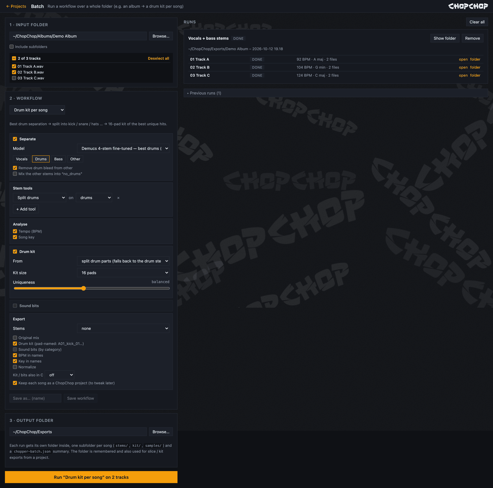

Run a workflow over every track in a folder, e.g. a drum kit for each song of an album.

1. **Input folder:** browse to it and untick tracks you don't want (**Deselect all** /
   select all at the top of the list). Optionally include subfolders.
2. **Workflow:** start from a preset and change any step, or save your own:

   | Preset | What it does |
   |---|---|
   | Drum kit per song | best-drums Demucs → keep drums → split drums → 16-pad kit from the parts → export the kit |
   | Vocals + bass stems | two-stage separation, keep vocals and bass → export the stems |
   | All stems | two-stage 6-stem separation → export every stem |
   | Stems + samples | all stems + a 16-pad kit from the split drums + vocal and bass chops |
   | Acapellas | best vocal model → de-reverbed acapella + instrumental |

   The steps are **Separate** (model, stems, remainder) → **Stem tools** (any tool on any
   stem) → **Analyse** (tempo, song key) → **Drum kit** (source, size, uniqueness) →
   **Sound bits** (stems, chops / phrases, how many) → **Export** (stems, original mix, kit,
   bits, BPM / key in names, normalize, also in C). You can keep each song as a project to
   fine-tune later. [Node workflows](#10-workflows) are listed here too, and **Export** /
   **Import…** [share presets](#sharing-workflows) as files.
3. **Output folder:** it starts at your [export folder](#the-export-folder), and a folder you
   pick here becomes the new export folder. Each run gets its own folder, one subfolder per
   song (`stems/`, `kit/`, `samples/`), and a `chopchop-batch.json` summary.

Songs run one after another, with live progress for each step:

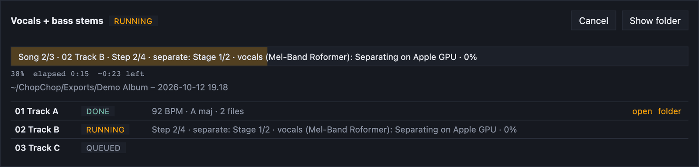

A song that fails is reported and the batch goes on. **Cancel** stops between steps.
**open** jumps to a song's project, and **folder** opens its files.

Earlier runs are read back from their `chopchop-batch.json`, so they stay listed after a
restart. They're found in the export folder, `data/batches/`, the output folder, and the
input folder you load (e.g. a folder of old exports); runs from the command line show up
too. **Remove** and **Clear all** only hide runs from the list (remembered in
`data/settings.json`); their files stay on disk.

---

## 10. Workflows

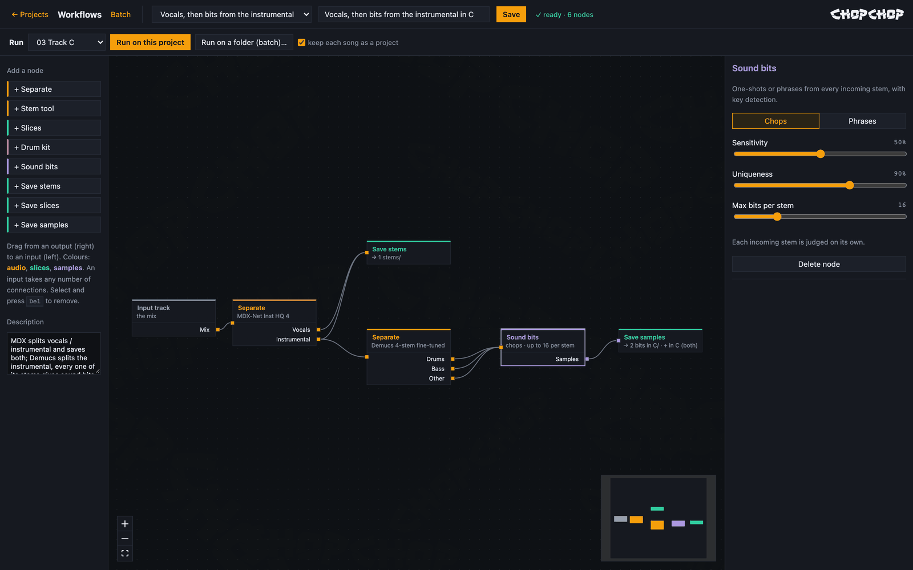

**Workflows** chains steps as a graph of nodes, for chains a fixed recipe can't express. The
example above:

- **Stage 1:** MDX splits the song into vocals and instrumental, and both are saved.
- **Stage 2:** Demucs splits the instrumental into drums, bass and other. All three feed one
  **Sound bits** node, whose bits are saved together with copies transposed to C.

How it works:

- **Nodes** (palette on the left): **Separate** (any model, which stems to keep, mix the
  rest, de-bleed), **Stem tool**, **Slices** (detect hits or beat grid), **Drum kit**,
  **Sound bits**, **Save stems**, **Save slices** and **Save samples** (with → C and pad
  names). **Separate** and **Stem tool** get one output per stem or part, so a 2-stem MDX
  model gives *vocals* and *instrumental*.
- **Connecting:** drag from an output to an input. Connections carry **audio** (orange),
  **slices** (cyan) or **samples** (purple), and only matching kinds connect; loops are
  refused. An input takes as many connections as you like: connect every stem into one Sound
  bits node, or several kits into one Save. Changing a model drops connections from stems it
  no longer makes.
- **Options:** select a node to see all of them on the right.
- **Checking:** the top bar shows **✓ ready**, or what's wrong.
- **Running** (the bar under the top bar):
  - on one track: **Run on this project**, or **Workflow…** in a project's top bar;
  - on a folder: **Run on a folder (batch)…**, or choose it on the Batch page under
    *Node workflows*. Each song becomes a project, with one subfolder per song.

Stems of a stem are named after it (`instrumental_drums`) and never replace existing tracks.
New stems, chops and samples stay in the project, so you can keep working on them. **Save**
keeps a workflow for later (`data/flows.json`); three examples are there to start from.

### Sharing workflows

**Export** saves the workflow as a `<name>.chopchop.json` file; **Import…** loads one, on the
Workflows page or the Batch page. Both kinds of preset work (node workflows and batch
recipes), as does a file holding several, or what `chopchop workflow NAME` prints:

- A preset whose name is taken is imported as "<name> (imported)", never over yours.
- Everything in the file is checked first, so a broken file imports nothing and says what's
  wrong.
- A preset using a model you don't have (one someone added on their machine) is refused,
  naming the model: add it on the [Models](#11-models) page, then import again.

---

## 11. Models

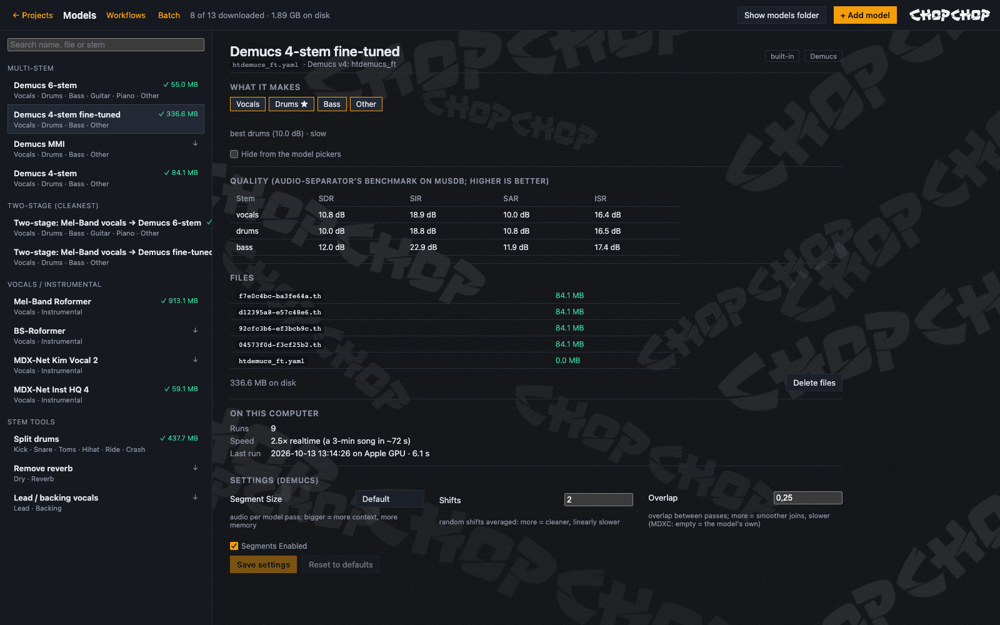

**Models** (top bar, or **Manage models →** under the model picker) lists every model: the
separation models, the stem tools' models, and any you added. For each one:

- what it makes, and what it's best at (★);
- its architecture (MDX-Net, MDX23C / Roformer, VR, Demucs) and its catalog name;
- quality scores per stem (SDR / SIR / SAR / ISR);
- its files, with sizes and whether they're downloaded;
- how fast it runs on your computer, and the GPU batch / precision in use;
- every setting its architecture has, e.g. segment size, overlap and denoise (MDX-Net);
  segment size and pitch shift (Roformer); window size, aggression and TTA (VR); shifts and
  segments (Demucs).

Changed settings apply every time the model runs, and **Reset to defaults** puts them back.
**Download now** fetches a model ahead of time. **Delete files** frees the space, keeping any
file another model shares. **Hide from the model pickers** keeps the lists short; saved
workflows that use a hidden model still work.

**+ Add model** brings in more:

- **From the catalog:** any of the ~170 UVR models audio-separator knows, with search,
  architecture filters and quality scores. The stems and "best for" are filled in.
- **Your own files:** a model audio-separator doesn't list, e.g. a new Roformer from Hugging
  Face (`.ckpt` + its `.yaml`; the stems are read from the config), or an MDX-Net `.onnx`
  with the parameters it was trained with. The files are copied into `data/models/`.

Either way, you set its name, group, stems, best-for, a note, and renames for outputs the
model names differently (e.g. `other=instrumental`). An added model appears in every model
picker (separation, batch and workflows) and can be edited or removed later.

---

## 12. Command line

Batches also run from a terminal, with no browser or server needed. Inside the venv the
command is `chopchop`; anywhere, `python scripts/run.py batch …` does the same.

```sh
chopchop workflows                                        # list presets + saved workflows
chopchop batch ~/Music/Album -w "Drum kit per song"       # a drum kit per song
chopchop batch ~/Music/Album -w "All stems" --stems vocals,bass -o ~/Stems
chopchop batch ~/Music/Album -w "Drum kit per song" --kit-size 32 --only "0[1-3]*" --dry-run
chopchop workflow "Acapellas" > mine.json                 # export a workflow, edit it…
chopchop batch ~/Music/Album --workflow-file mine.json    # …and run it
```

A dry run prints the plan without processing anything:

```text
$ chopchop batch "~/ChopChop/Albums/Demo Album" -w "drum kit per song" --to-c both --dry-run
Workflow: Drum kit per song
  • separate with Demucs 4-stem fine-tuned → keep drums
  • Split drums on drums
  • detect tempo and key
  • 16-pad drum kit from parts
  • export stems: none, kit, keyed sounds also in C (both)
Tracks (3):
  01 Track A.wav
  02 Track B.wav
  03 Track C.wav
Output: ~/ChopChop/Exports/Demo Album – 2026-10-12 19.19
(dry run: nothing was processed)
```

- **Overrides** tweak the chosen workflow for that run only (`chopchop batch --help` lists
  them all):
  - separation: `--model`, `--stems`, `--rest` / `--no-rest`, `--no-separate`, `--no-debleed`;
  - tools: `--tool drumsep:drums` (repeatable), `--no-tools`;
  - kit and sound bits: `--kit-size`, `--kit-source`, `--no-kit`, `--uniqueness`,
    `--bits vocals,bass`, `--bits-mode`;
  - export: `--export-stems all|kept|none|LIST`, `--export-mix`, `--no-bpm-names`,
    `--no-key-names`, `--normalize`, `--to-c repitched|warped|both`,
    `--keep-projects` / `--no-keep-projects`;
  - input / output: `-o DIR`, `-r` (subfolders), `--only PATTERN`.
- **Progress:** a live status line (song, step, model download, GPU progress), then one ✓ / ✗
  line per song. `-q` keeps only the per-song lines.
- **Ctrl+C** stops after the current step, and the results so far stay in the output folder.
  Press it twice to quit immediately.
- **Scripting:** `--json` prints the result as JSON on stdout, with progress on stderr. Exit
  codes: `0` all songs done · `1` some failed · `2` bad usage · `130` cancelled.
- **Data folder:** the command line and the app share it, so kept projects show up in the
  app (`--data DIR` uses another one).

---

## 13. GPU speed and tuning

ChopChop uses the separation library's defaults on NVIDIA cards (one chunk at a time, full
precision), which are safe on every card. Larger batches and half precision (fp16) can speed
up the Roformer, MDX23C and MDX-Net models on some cards and slow them down on others; on
Windows, a batch too big for the card doesn't even fail, it quietly spills into system RAM
and everything crawls. So measure instead of guessing:

```sh
chopchop benchmark "path/to/a typical song.wav"     # or: python scripts/run.py benchmark …
```

- It times each model on a 30-second clip with each setting (batch 1 or a size based on free
  VRAM, fp16 on or off), prints the times, and saves a setting only if it was clearly faster
  (≥ 7%) without falling back to CPU. `--no-save` only reports.
- Overrides, set before starting ChopChop: `CHOPCHOP_GPU_BATCH=N` and `CHOPCHOP_FP16=0|1`.
- **Demucs isn't tunable.** It processes one ~7.8 s segment at a time and doesn't use fp16,
  so it uses about 2 GB of VRAM whatever the card. That's expected, not a sign the GPU is idle.
- **Every separation is logged** to `perf.log` in the data folder: model, device, settings,
  seconds, and whether it fell back to CPU. The [Models](#11-models) page shows these as each
  model's speed. If a GPU run fails, ChopChop finishes on the CPU and says so in the progress
  ("GPU failed (…), finishing on CPU"), so a silent CPU run can't pass for "the GPU got slow".
- To see real GPU load on Windows, use Task Manager → Performance → GPU, and switch one of the
  small graphs from "3D" to **"Cuda"** (or "Compute_0").

---

## 14. Keyboard shortcuts and undo

| Key | Action |
| --- | --- |
| <kbd>Space</kbd> | play / pause the focused lane |
| <kbd>S</kbd> | split / add a slice at the playhead |
| <kbd>⌥/Alt</kbd> + drag, <kbd>⌥/Alt</kbd>+<kbd>S</kbd> | chop the focused stem only |
| <kbd>O</kbd> | toggle "only this stem" mode |
| <kbd>L</kbd> | toggle loop for the selected chop |
| <kbd>←</kbd> / <kbd>→</kbd> | step through slices and play them |
| <kbd>Del</kbd> | delete the selected slice |
| <kbd>Enter</kbd> | save the selected slice as a sample |
| <kbd>B</kbd> | make the hit at the playhead bar 1 |
| <kbd>Esc</kbd> | deselect |
| <kbd>⌘Z</kbd> / <kbd>Ctrl+Z</kbd> | undo |
| <kbd>⌘⇧Z</kbd> / <kbd>Ctrl+Shift+Z</kbd> or <kbd>Ctrl+Y</kbd> | redo |
| pad keys | play the drum pads (see [Drum pads](#7-drum-pads)) |

**Undo** also lives in the top bar (↶ ↷), and the tooltips name the step, e.g. "Undo Delete
slice".

- **It covers** slice edits, pad changes, sample deletes, renames and trims, kit rebuilds,
  stem imports or removals, stem separation (one step), and tempo changes. A workflow run
  adds one step per separation, chop or kit it makes.
- **Deleted and replaced audio** is kept until no undo step needs it, so undoing a delete or
  a trim brings the sound back.
- **Limits:** up to 100 steps per project; the history lasts until the server restarts.
- **In text fields**, Ctrl+Z / ⌘Z does the normal text undo instead.

---

## 15. How the detection works

Everything is heuristic DSP (librosa / numpy), with no training data.

- **Peaks.** Onsets use a SuperFlux onset envelope. Each onset must raise the energy in at
  least one frequency band, so a kick's pitch sweep doesn't trigger a false slice while a hat
  over a ringing kick still does. It also has to pass a loudness gate, and the slice start is
  snapped to the attack.
- **Drum hits.** Each hit's start is snapped to its attack using fine-resolution spectral
  flux. The spectrum of whatever was ringing just before the hit is subtracted as bleed. The
  hit is then labelled from its band energies (sub, low, mid, high, air), noisiness, decay
  time and clap-style repeated bursts.
- **Keeping the best unique hits.** Each hit gets a timbre fingerprint: its mel spectrum in
  five time windows. The same drum sound re-triggered scores about 0.97–1.0; two different
  kicks score about 0.8–0.88.
  - Hits are visited from cleanest to messiest. Quality means loud, isolated from what came
    before, and not cut off by the next hit.
  - A hit joins the cluster of the most similar sound already kept when their similarity is
    above the **Uniqueness** threshold; otherwise it starts a new cluster. Each cluster's
    representative is its best-sounding take, and the cluster size is the occurrence count.
  - Near-identical sounds in different categories are merged, e.g. a snare once misread as
    a clap.
- **Auto kit.** Picks the kit round-robin across drum types, so a 16-pad kit gets variety
  before depth.
- **Tempo (BPM).**
  - Candidate tempos are scored by how periodic the drum hits are at 1, 2 and 4 beats. Swing
    shifts the off-beat hats but not the quarter-note pulse, so swung and straight grooves
    read the same tempo.
  - Individual beats are tracked and snapped to real hits, so the grid follows a drummer who
    speeds up or slows down.
  - Steady tracks get a sub-frame precise BPM from a straight-line fit over all the beats;
    drifting tracks report the median and the range, e.g. `92.3–95.4`.
  - Swing is measured from where the off-beat hits fall between beats, MPC-style, e.g.
    `60% (16ths)`.
  - **Confidence** is shown as a breakdown: *clarity* (how clearly one tempo stands out),
    *stability* (whether it holds across the track), *on grid* (how many beats land on a
    hit), *timing* (how tight the playing is) and *half/double* (how sure it isn't half or
    double time). For the classic half / double ambiguity (72 vs 144) the panel lists the
    alternatives, with ÷2 / ×2 buttons, typing and tap tempo.
- **Sound bits from pitched stems** (other, vocals, guitar, piano, bass):
  - Drum bleed is mostly removed during separation (see *Remove drum bleed*).
  - Bits must be audible in the song (no more than 40 dB below its peak), so a near-empty
    stem gives nothing rather than leftovers.
  - Kick-like bits are dropped, except on bass, where 808s belong.
  - Only the bits about to be kept are checked for being mostly percussive, and the
    next-best candidate replaces one that is.
  - Drum stems and the full mix keep their hits, filed by drum type.
- **Key.** One-shots under 1.5 s get a note from pYIN pitch tracking (e.g. `F#1`). Longer
  bits get a key from chroma matched against Krumhansl–Kessler profiles (e.g. `A min`).
  Relative major and minor keys can be confused on short phrases, so keys are editable.

---

<sub>Screenshots: "Medicine" by Gvidon (Pixabay), separated with Demucs 6-stem on an Apple
GPU. Folder paths are shown as `~/ChopChop/…`.</sub>
